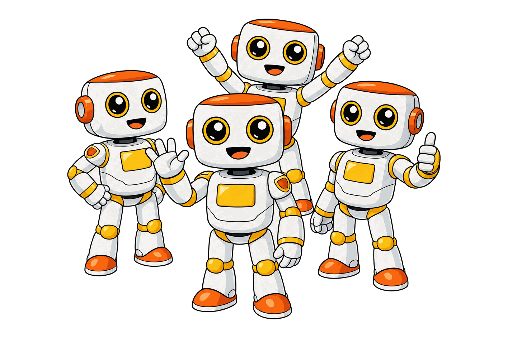

# kromatic-dev-stack

**The delivery workflow [Kromatic](https://kromatic.com) uses to ship software** — seven agent personas with human gates between them.

<p align="center">
  
</p>

**Quickstart — copy and paste this prompt into your agent of choice:**

```
Please examine the installation instructions at
https://github.com/Kromatic-Innovation/kromatic-dev-stack and set this up for me.
Read the README, INSTALL.md, and ASSUMPTIONS.md, then run the harness-adopt
skill: assess how my team already works, tell me which roles are worth
installing and which to skip, and install only the ones I approve — adapted to
my conventions. Ask me before each one.
```

Full detail, including manual installation, is in **[INSTALL.md](INSTALL.md)**.

## Why bother

Most agent setups are one very capable assistant with a long prompt. Multi-agent frameworks usually split work by *task* — a researcher, a coder, a tester — which is a division of labor.

This is a division of **authority**. Each role is defined as much by what it may not do as by what it does:

- The product manager may not choose a database.
- The developer may not decide what to build.
- The QA reviewer reports findings but does not decide which ones block the merge.
- The orchestrator never writes implementation code, no matter how small the fix.

Those refusals are the entire point. An agent that can do everything will confidently build the wrong thing very well, and nothing in the run will flag it — because the thing that would have objected is the same thing that made the decision.

### What you actually get

None of the underlying ideas are new. They're the practices that made agile and lean startup work for human teams — small batches, explicit done, measure before you conclude, improve the process itself — encoded as rules an agent has to follow rather than habits a team is supposed to remember. Agents are very good at following a process consistently and very bad at noticing when they've quietly stopped. That's the whole bet.

- **People stop being the bottleneck.** A person is required at two decisions — what gets built, and what ships. Everything between those runs without waiting on anyone's calendar.
- **Work arrives in small pieces.** Scope is cut to the smallest useful slice before anything starts, so changing your mind is cheap and a wrong turn costs days rather than quarters.
- **Fewer things get built that nobody wanted.** The product conversation happens before the code, and it's adversarial by design — the role's job is to push back on the request, not to take the order.
- **Every change has a success measure agreed up front**, including what result would count as a failure. Deciding what "working" means after seeing the numbers is how everything ends up looking like a win.
- **Ideas don't get lost.** What doesn't make the current slice gets written down as tracked work before scope closes, so the good idea you deferred is still there next month.
- **Reviews end in decisions, not debates.** Whoever finds the problems doesn't decide which ones matter — that separation is what stops review from becoming either rubber-stamping or bikeshedding.
- **The process improves itself.** Retrospectives are a built-in step, and what they find turns into changes to these rules — proposed for your approval, never applied silently.
- **Nothing merges on a claim.** "The tests pass" isn't accepted as evidence a feature works; someone has to actually run it.

### Is any of it novel?

Mostly no, and we'd rather say so. Three things are genuinely less common:

1. **Roles bounded by refusals, not just responsibilities.** Most agent frameworks say what each agent does. The load-bearing half here is what each one is forbidden to do, because that's what preserves an independent check.
2. **Two named human gates instead of "human in the loop."** Continuous supervision doesn't scale and gets skipped under deadline. Two specific stopping points do scale, and their absence is obvious.
3. **A retrospective loop that edits the process.** Most workflows treat their own rules as fixed. Findings here are promoted back into the skills, which is why the rules read like scar tissue — they are.

### When it isn't worth it

If you're one person on one repo with one branch, most of this is overhead. Take the QA reviewer and the product gate and leave the rest — the adoption skill will tell you the same thing.

## The process

Seven roles, in the order they act. The **gates** are the load-bearing part: each one is a point where work stops until a condition is met.

**1. Product Manager** — *before anything is built*
Challenges the request rather than accepting it. Who is this for, what changes for them, what happens if we don't build it? Cuts the smallest version that would actually teach us something, writes down explicitly what is **not** in scope, and files the rest of the vision so it isn't lost.

> **GATE — scope lock (human).** Nothing proceeds until a person agrees on what is being built and what is excluded. This is the cheapest place in the whole process to change your mind.

**2. Orchestrator** — *turns approved scope into parallel work*
Breaks the work into **lanes** — independent workstreams, roughly one per repo or area, each sized to a single sitting. Where lanes depend on each other, it sequences them explicitly so lane B doesn't start on top of lane A's unfinished work. Then it dispatches specialists and holds every gate below. It coordinates; it does not implement.

**3. Architect** — *only when the change is structural*
Skipped for a clear bug fix. Runs when work crosses a module boundary, touches a schema, or raises a "should this be split?" question. Sets the structural boundaries **before** anyone writes code, and reviews for root cause rather than symptom afterward.

**4. Designer** — *only when a person or another system will use it*
Defines the intended experience before implementation, covering the states teams routinely forget: empty, loading, and error, not just the happy path. Covers machine-facing surfaces too — an API another agent consumes has a user experience, and it's usually worse than the human one.

**5. Developer** — *builds it*
Owns the change end to end: implement, test, open the pull request, keep it green. Does not decide what to build, and does not decide what gets fixed after review.

> **GATE — checks green.** No review starts on a red build. Reviewing broken work wastes the reviewer.

**6. QA** — *reviews what was built*
Audits test quality and conventions, and ranks what it finds by how much damage each could do. It does not decide what gets fixed — it hands the ranked list back to the orchestrator, who classifies each finding as must-fix, should-fix, or won't-fix, with a reason.

> **GATE — verify by running.** Before merge, someone drives the actual change and observes it working. A passing test suite does not satisfy this.

> **GATE — merge (human).** The second and last place a person is required.

**7. Analyst** — *closes the loop*
Defines the success metric **before** the change ships — including what result would count as a failure — and reads out the actual result afterward. Deciding what "working" means after you've seen the numbers is how every change ends up looking like a win.

Then the loop closes: what the analyst learns becomes the next product conversation.

## Skills as personas

Each role ships as a named persona you invoke directly — `/perlman`, `/occam`, `/dorothy`. The names exist because `/quine` is easier to remember and call than `/qa-test-quality-reviewer`, and because a named colleague with opinions is easier to think with than a configuration profile.

They're named for historical figures whose actual work maps to the role:

| Persona | Role | Named for |
|---|---|---|
| **Perlman** | Product Manager | Radia Perlman, who invented the protocol that stops a distributed system looping forever |
| **Occam** | Orchestrator | William of Ockham, the 14th-century friar whose razor says don't multiply entities beyond necessity — which is most of an orchestrator's job |
| **Zaha** | Architect | Zaha Hadid, the first woman to win the Pritzker Prize for architecture |
| **Eiko** | Designer | Eiko Ishioka, the Oscar-winning designer whose work spanned film, stage, and advertising |
| **Dorothy** | Developer | Dorothy Vaughan, who led NASA's West Area Computing unit and taught herself FORTRAN to keep her team employed |
| **Quine** | QA | W.V.O. Quine, the logician — and a quine is also a program that reproduces its own source |
| **Aristotle** | Analyst | Aristotle, who insisted conclusions come from observation rather than from how good the argument sounds |

**The names are a convention, not a dependency.** Nothing keys off them except the folder name, the `name:` field, and the references the personas make to each other. Rename them to suit your team — just change all three together or the handoffs break silently. `/harness-adopt` will do it properly.

## What is deliberately not here

This bundle ships the *delivery* half of our workflow. Left out on purpose:

- **Strategy and governance roles.** Where a gate says to escalate a strategic question ("is this still the right business to be in?") or a governance one ("this rule needs to change everywhere"), send it to your own equivalent or to a person. Don't invent a persona to absorb it.
- **Our overnight build queue.** We run automation that picks up approved tickets and builds them unattended. The skills describe how to work safely *alongside* something like that — locking, handoff races — in general terms, so the rules make sense whether or not you run one.
- **Deployment setup, repository rules, and credential wiring.** Yours will differ, and ours isn't interesting.

### Optional companions

- **[`ideate-core`](https://www.npmjs.com/package/ideate-core)** — our ideation engine on npm. The product manager's imagine step can call it to generate and stress-test a range of candidate directions instead of anchoring on the first one. `npm install ideate-core`.
- **`kromatic.com/mcp`** — our hosted MCP server, if you want the personas to reach our published lean-startup material directly.

## Why we published it

We're an AI and innovation transformation consultancy. This bundle is one artifact of that work — it's how we actually ship with clients, which makes it the most honest thing we can show you about what working with us is like. Transformation isn't a deck; it's whether your team can put agents into a real delivery process and still trust what comes out the other end. That's what the gates are for.

If the model is useful to you, take it — that's the whole intent. If you'd rather we ran it with you, [that's what we do](https://kromatic.com).

Issues and pull requests welcome, particularly "this rule didn't survive contact with my setup" reports — those are the most useful thing you can send us.

## Questions

**For questions on this development stack, how to use it, or how to integrate it with your team, reach us at [kromatic.com/contact-us](https://kromatic.com/contact-us).**

We're happy to talk through adoption whether or not you're a client — including telling you which parts of this you should skip.

## License

MIT. See [LICENSE](LICENSE).
